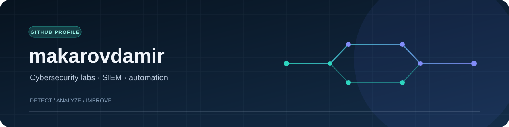

  

<h1 align="center">Привет! Я <code>@makarovdamir</code></h1>

  Изучаю и собираю практические проекты в области кибербезопасности и автоматизации.

  
  
  
  

## 🔐 Проект: SIEM / IDPS AI

Лабораторный SOC L1-прототип: **Wazuh** собирает события и применяет правила обнаружения, **n8n** организует AI-триаж, а **Telegram** доставляет алерты оператору для ручного решения.

- 🛡️ Лабораторное обнаружение SSH brute force и правила Wazuh
- 🧠 Санитизация алертов и AI-помощь при разборе
- 📣 Уведомления и подтверждаемая оператором реакция
- 🧪 Docker-лаборатория, Windows Agent installer и документация

**Репозиторий проекта приватный** — его файлы не опубликованы на этой странице и доступны только владельцу/приглашённым участникам: [SIEM / IDPS AI](https://github.com/makarovdamir/my-private-project).

> Учебный прототип, не production SOC/IDS/IPS. Любые проверки выполняются только в изолированной лаборатории или с разрешения владельца систем.

## 🧰 Инструменты проекта

  
  
  
  
  

## 📌 Сейчас в фокусе

- Улучшение лабораторных сценариев и качества обнаружения
- Безопасная настройка интеграций и ограничение доступа
- Документирование проверок, ограничений и следующих шагов

---

Профиль и описание проекта — на русском. Репозиторий SIEM / IDPS AI остаётся приватным.
